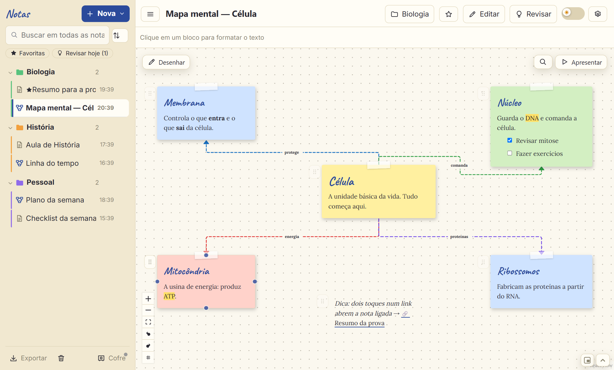
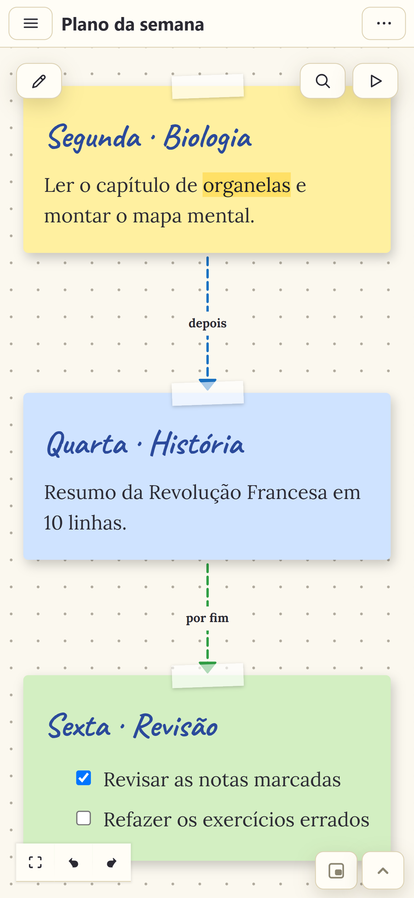
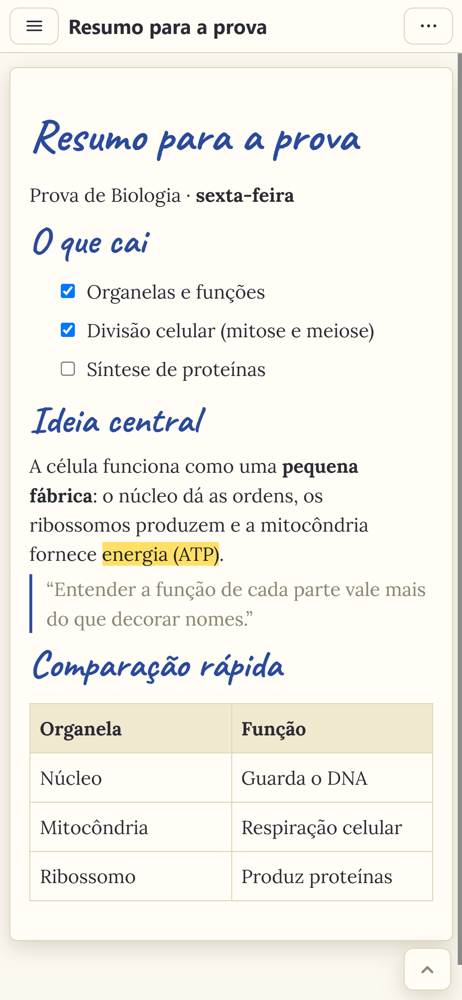
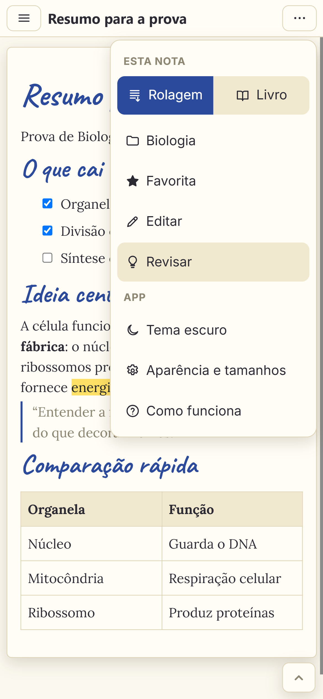
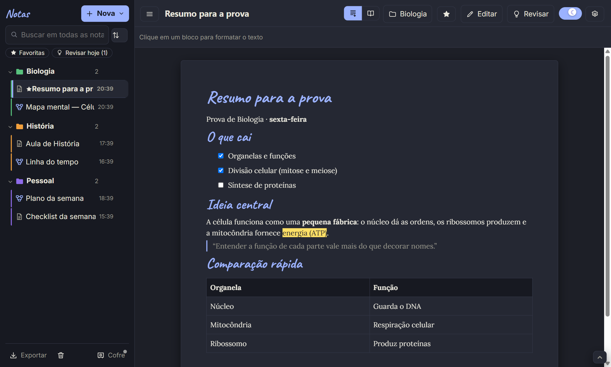

# Notes Dim

A note-taking app for studying: an infinite canvas for mind maps, sticky notes, arrows and freehand drawing, plus plain text notes.
Windows and Android. No account, no ads, no telemetry.

[Download](https://github.com/Fred-22-glitch/notes-dim/releases/latest) · [Changelog](CHANGELOG.md) · [Guide](docs/GUIDE.md) · [Privacy](docs/PRIVACY.md)

---

> Available in English, Spanish and Portuguese (⚙ → language).

## Features

**Canvas**
- Sticky notes, rectangles, ellipses and frames (moving a frame moves what's inside it)
- Arrows with heads, colors, dashes, labels and draggable curves
- Freehand drawing: pen, highlighter and an eraser that only erases where it passes
- Alignment guides, snap to grid, minimap and search inside the canvas
- Lasso selection on Android: tap the lasso button and draw around notes to select several at once
- Presentation mode (one frame at a time, fullscreen)
- Undo/redo, duplicate, copy and paste between notes

**Text notes**
- 25 fonts, colors, highlighter, headings, lists, checklists, tables, images, quotes and code blocks
- Continuous scroll or book mode (side-turning pages)
- Links between notes (`[[` or Ctrl+K) and full-text search
- ABNT (Brazilian standard) references and citations
- Templates: lecture, summary, exam review, reading notes, thesis chapter, exam study schedule, mistakes log, and an ABNT reading-notes form that builds the cover, reference and page-numbered quotes

**Studying**
- Hide selected text and reveal it in Review mode
- Spaced repetition (1, 3, 7, 15, 30 and 60 days) with a "review today" filter
- Read aloud: the whole note or the selected text, using the device's voice (hidden text is skipped in Review mode)
- Flashcards from a note (hidden text, bold, definitions, lists, tables, dates, labeled arrows) or written by hand, with spaced repetition; pick how many to study, shuffle, swipe on touch devices
- Calendar: note reviews, flashcards due, and dates and tasks written in your notes; tap a day to create a journal, meeting, class or to-do note for it
- Study streak: days in a row, a weekly goal you pick, and a calendar
- Word goals, tags, favorites and read-only mode
- Themes that restyle the whole app: Notebook (light/dark), Graph paper, Coffee, Marble and gold, Heirloom notebook, Watercolor, Polaroid
- In-note search, back/forward between notes, multi-select to move or trash notes
- Animated how-to and a short welcome tour

**Data**
- Notes are stored as `.json` files in a folder you pick (the "vault"). Point it at a Syncthing folder to keep PC and phone in sync
- Daily automatic backups, per-note version history, 30-day trash
- Export to PDF, Word, Markdown, HTML, PNG (canvas) and Obsidian `.canvas`
- Notebook-style PDF (lined paper) and a story-sized or square image of a note for sharing

## Android

&nbsp;&nbsp;
&nbsp;&nbsp;

Same features as the desktop version, adapted for touch: long-press the background to create, double-tap a link to open it, and the formatting bar sits above the keyboard.

## Install

Grab the files from the [latest release](https://github.com/Fred-22-glitch/notes-dim/releases/latest).

- **Windows:** `Notes-Dim-Instalador-x.y.z.exe` (installer) or `Notes-Dim-Portatil-x.y.z.exe` (portable). The installer isn't code-signed, so SmartScreen may warn you: *More info → Run anyway*.
- **Android:** `Notes-Dim-x.y.z.apk`. You'll need to allow installing apps from unknown sources for your browser or file manager.

The installed Windows version and the Android app check GitHub Releases for updates and install them from inside the app. The portable version opens the release page instead.

## Getting started

1. On first launch, pick a folder for your notes (you can skip this and do it later).
2. Right-click the canvas background (long-press on Android) and choose a block type.
3. Drag the blue dot on a note's edge to another note to connect them.

The full guide is in the app under **⚙ → How it works**, and in [docs/GUIDE.md](docs/GUIDE.md).

## Privacy

No account, no ads, no analytics. Notes stay on your device and in the folder you choose. The only network request is the update check against the GitHub API. Details in [docs/PRIVACY.md](docs/PRIVACY.md).

## Bugs and feature requests

Use [Issues](https://github.com/Fred-22-glitch/notes-dim/issues/new/choose). Reports in English or Portuguese are fine.

## Notes Dim Pro

Everything above is free. Pro is a one-time payment (no subscription) that adds:

- Study AI that runs on the device (Qwen3 4B on Windows, Qwen3 1.7B on Android; downloaded once from Hugging Face): summary, main topics, quote wall, flashcards, study plan until an exam date, and automatic mind map. Long notes can go through ChatGPT, Gemini or Claude with a ready-made prompt instead. Expect seconds per chunk on a PC with a GPU and a few minutes per chunk on a phone; the Pro screen shows an estimate for your device before you buy.
- Reading mode: read-aloud highlights the current word
- Three extra themes: Vintage cassette, Soft cyberpunk and Melted ice cream
- Text → mind map from headings, ENEM study pack and essay map templates
- Notebook PDF and share image without the watermark, plus extra paper styles and colors

You get an activation key by email and paste it under ⚙ → Notes Dim Pro. It's checked offline; no account needed.

## Support

If you'd like to support development without buying Pro:

- **Ko-fi** (card or PayPal): https://ko-fi.com/glitch22f
- **Pix** (Brazil only): [payment link](https://nubank.com.br/cobrar/xx14o/6ade9685-dae0-492a-bbc8-c0c2d7317304), or in the app under ⚙ → Support Notes Dim

## License

Free to use on any number of devices. Notes Dim is proprietary software: this repository contains releases and documentation, not source code. See [LICENSE](LICENSE).

Built with React, React Flow, TipTap, Electron, Capacitor and Fontsource, among others. The full list of third-party licenses is in the app under ⚙ → Open source licenses.

© 2026 Dim
