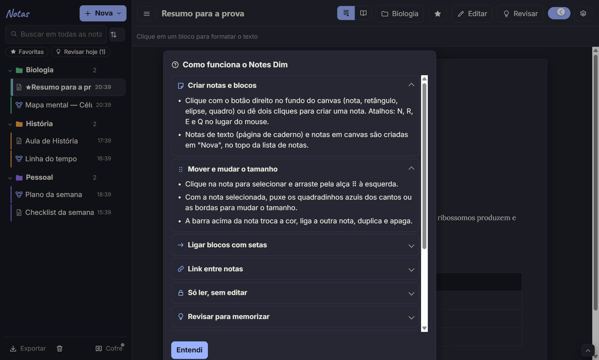

# Notes Dim

**Notas para estudar do jeito que a sua cabeça pensa.**
Mapas mentais, post-its, setas e desenho à mão num quadro infinito — e notas de texto que viram caderno ou livro.
Leve, rápido, sem conta e sem anúncios. No **PC (Windows)** e no **Android**.

[**Baixar a versão mais nova**](https://github.com/Fred-22-glitch/notes-dim/releases/latest) · [Novidades](docs/NOVIDADES.md) · [Como funciona](docs/GUIA.md) · [Privacidade](docs/PRIVACIDADE.md)

---

## Por que o Notes Dim

O Notes Dim não quer ser um Notion nem um Obsidian. Ele faz **o básico de quem estuda** — e faz bem feito:

- **Abre na hora e não atrapalha.** Clicou, escreveu. Sem configuração, sem login, sem curva de aprendizado.
- **Pensa em mapas, não só em listas.** Post-its coloridos, setas com texto, quadros que agrupam ideias e um canvas que não acaba.
- **Feito para memorizar.** Esconda trechos, revise com o modo Revisar e deixe o app lembrar a próxima revisão (1, 3, 7, 15, 30 e 60 dias).
- **Suas notas são suas.** Ficam no seu aparelho e na pasta que você escolher. Nada vai para servidor nenhum.
- **PC e celular com as mesmas funções**, cada um com o jeito certo de usar: mouse e teclado no PC, toque e gaveta no celular.

## O que dá para fazer

<table>
<tr>
<td width="50%" valign="top">

### Canvas
- Post-its, retângulos, elipses e **quadros** que levam as notas de dentro junto
- **Setas** com ponta, cor, tracejado e texto; soltar a seta no vazio cria uma nota ligada
- **Desenho à mão** (caneta, marca-texto e borracha que apaga só por onde passa)
- Guias de alinhamento, encaixe na grade, minimapa e **busca dentro do canvas**
- **Modo apresentação**: um quadro por vez, em tela cheia
- Desfazer/refazer, duplicar, copiar e colar entre notas

</td>
<td width="50%" valign="top">

### Notas de texto
- Página de caderno com **25 fontes**, cores, marca-texto, títulos e listas
- Tarefas, tabelas completas, imagens, citações e código
- **Rolagem** contínua ou **modo Livro** com páginas passadas de lado
- **Links entre notas** (`[[` ou Ctrl+K) e busca em todas as notas
- **Referências ABNT** e citações prontas para o TCC
- Modelos: aula, resumo, revisão para prova, fichamento, capítulo do TCC…

</td>
</tr>
<tr>
<td valign="top">

### Estudo e memória
- Marque trechos e esconda no modo **Revisar** — toque para revelar
- **Revisão espaçada** com filtro "Revisar hoje"
- Meta de palavras por nota, etiquetas e favoritas
- Modo **só leitura** para estudar sem estragar nada

</td>
<td valign="top">

### Seus dados, seguros
- **Cofre**: escolha a pasta das notas (dá para sincronizar PC e celular com o Syncthing)
- **Backup automático** diário e histórico de versões de cada nota
- Lixeira com 30 dias para recuperar
- Exporta PDF, Word, Markdown, HTML, imagem do canvas e `.canvas` do Obsidian

</td>
</tr>
</table>

## Também no celular

&nbsp;&nbsp;
&nbsp;&nbsp;

No Android o Notes Dim usa toque de verdade: **segure o dedo** no fundo para criar, **toque duas vezes** para abrir um link, a barra de formatação aparece **logo acima do teclado** só quando você escreve.

## Instalar

| | Como instalar |
|---|---|
| **Windows** | Baixe o `Notes-Dim-Instalador-x.y.z.exe` na [página da versão mais nova](https://github.com/Fred-22-glitch/notes-dim/releases/latest) e abra. Se o Windows mostrar "O Windows protegeu o computador", clique em **Mais informações → Executar assim mesmo**. Quer sem instalar? Use o `Notes-Dim-Portatil-x.y.z.exe`. |
| **Android** | Baixe o `Notes-Dim-x.y.z.apk` no celular e abra. O Android pede para permitir "instalar apps desconhecidos" — é só permitir para o navegador ou para o app de arquivos. |

**Atualizações chegam sozinhas:** quando sai uma versão nova, o app avisa e atualiza com um toque.

## Primeiros passos

1. Ao abrir, escolha a **pasta do Cofre** (onde as notas ficam guardadas) — ou deixe para depois.
2. Clique com o **botão direito** no fundo (no celular, **segure o dedo**) e escolha "Nova nota aqui".
3. Puxe a bolinha azul de uma nota até outra para ligar as ideias.
4. Dúvidas? No app, abra **⚙ → Como funciona** ou leia o [guia completo](docs/GUIA.md).

## Privacidade

O Notes Dim **não tem conta, não tem anúncios e não coleta dados**. As notas ficam no seu aparelho e na pasta que você escolher. A única conexão com a internet é para procurar atualizações aqui no GitHub. Leia a [política de privacidade](docs/PRIVACIDADE.md).

## Problemas e sugestões

Encontrou um erro ou tem uma ideia? [Abra um pedido aqui](https://github.com/Fred-22-glitch/notes-dim/issues/new/choose) — toda sugestão é lida.

## Apoie o Notes Dim

O Notes Dim é feito por uma pessoa só, sem anúncios e sem coletar seus dados. Se ele ajuda nos seus estudos, um apoio de **R$ 10,00** mantém o app vivo e acelera as próximas versões:

**[Apoiar com Pix (R$ 10,00)](https://nubank.com.br/cobrar/xx14o/6ade9685-dae0-492a-bbc8-c0c2d7317304)** — ou, dentro do app, em **⚙ → Apoie o Notes Dim** (com QR Code e Pix copia e cola).

Mora fora do Brasil? O Pix só funciona com bancos brasileiros — **[apoie pelo Ko-fi](https://ko-fi.com/glitch22f)** (cartão ou PayPal).

*Outside Brazil? Pix only works with Brazilian banks — you can **[support Notes Dim on Ko-fi](https://ko-fi.com/glitch22f)** (card or PayPal).*

Contar para um amigo que estuda também ajuda muito.

## Licença

O Notes Dim é **gratuito para usar**, em quantos aparelhos quiser. O código e a marca são de propriedade do autor — veja a [licença de uso](LICENSE).
O app usa bibliotecas de código aberto (React, React Flow, TipTap, Electron, Capacitor, Fontsource e outras); a lista completa, com as licenças, fica no app em **⚙ → Licenças de código aberto**.

Feito com cuidado por Dim · © 2026

